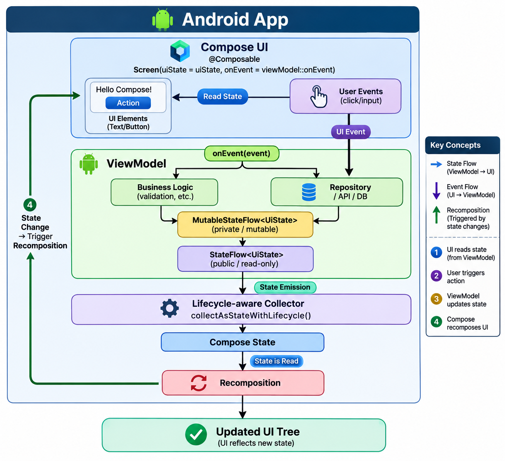
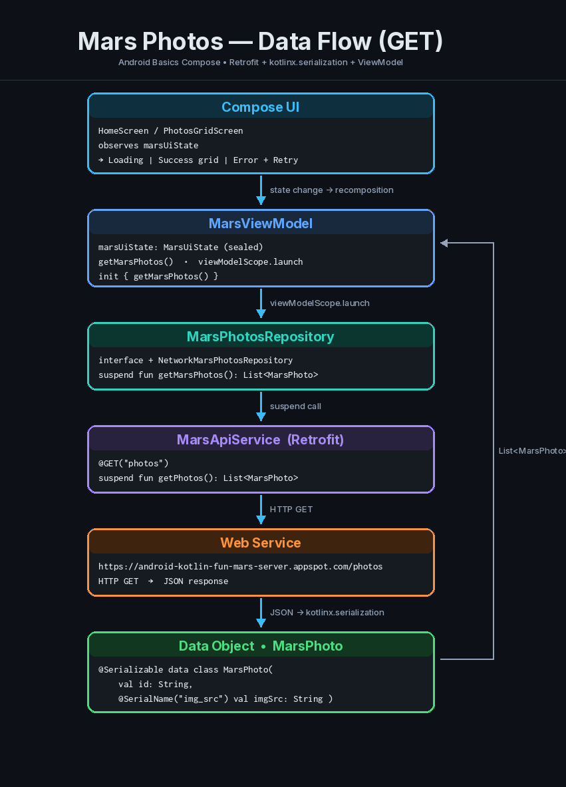
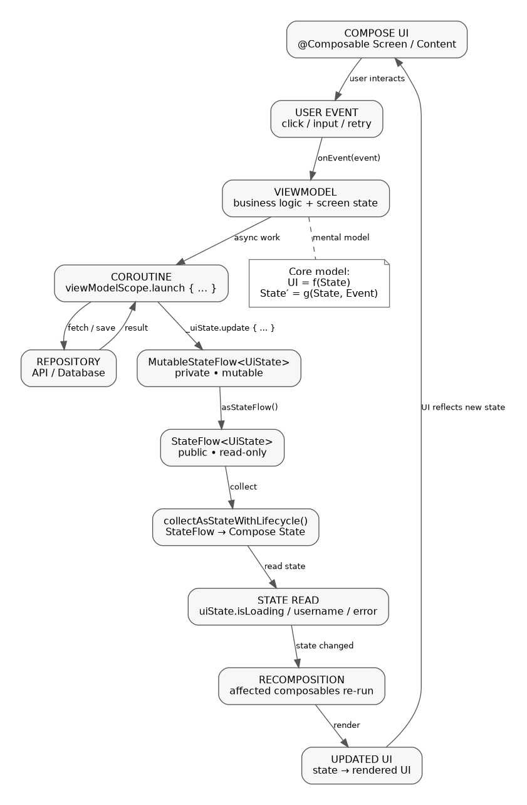
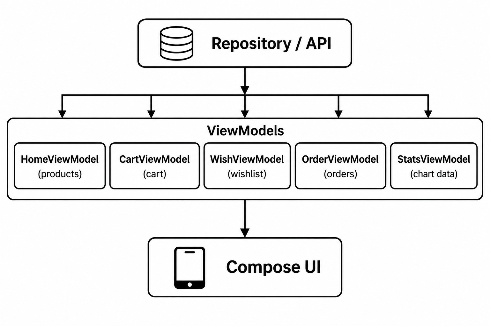

## Summary
Suppose your app has:
- Home → products
- Cart → cart items
- Wishlist → wishlist items
- Orders → order history
- Analytics → simple charts
- 
# Overview of State<->UI relationship

1. **General overview**



2. **Repository/Retrofit- Simple GET (no headers)**






## Solution/Structure:
**Summary**: **ViewModel** owns the state relevant to its UI, rather than all application state.

### 1. Overview


```kotlin
sealed interface CartUiState {
    data class Success(
        val items: List<CartItem>,
        val total: Double
    ) : CartUiState

    object Loading : CartUiState
    object Error : CartUiState
}
```

### ViewModels:

```CartViewModel```: Then your Cart screen doesn't care how the data was obtained:


```kotlin
class CartViewModel : ViewModel() {

    var uiState: CartUiState by mutableStateOf(CartUiState.Loading)
        private set

    init {
        loadCart()
    }

    private fun loadCart() {
        viewModelScope.launch {
            uiState = CartUiState.Loading

            uiState = try {
                val items = repository.getCart()

                CartUiState.Success(
                    items = items,
                    total = items.sumOf { it.price * it.quantity }
                )
            } catch (e: IOException) {
                CartUiState.Error
            } catch (e: HttpException) {
                CartUiState.Error
            }
        }
    }
}
```

**ViewModels summary:**

1.A pretty natural architecture would be this:

```text
CartViewModel
└── CartUiState
├── Loading
├── Error
└── Success(items, total)


WishlistViewModel
└── WishlistUiState
├── Loading
├── Error
└── Success(items)


OrderHistoryViewModel
└── OrderHistoryUiState
├── Loading
├── Error
└── Success(orders)
```

## 2. Repository/Network Layer(Retrofit)
Think of repository as the layer that gets data for your ViewModels(and app/)

```kotlin
class StoreRepository(
private val api: StoreApi
) {
suspend fun getCart() = api.getCart()
suspend fun getWishlist() = api.getWishlist()
suspend fun getOrders() = api.getOrders()
}
```


I've reorganized it into a compact reference document, keeping the original Kotlin examples while making the relationships between the layers, responsibilities, and data flow easier to recall.

# Android Architecture: ViewModels, UI State & Repository

## 1. The Scenario

Suppose your application has several screens, each fetching different data:

| Screen    | Responsibility        |
| --------- | --------------------- |
| Home      | Products              |
| Cart      | Cart items            |
| Wishlist  | Wishlist items        |
| Orders    | Order history         |
| Analytics | Statistics and charts |

**The architectural principle:**

Each ViewModel owns the state relevant to its UI, rather than having one giant ViewModel manage the entire application.

---

## 2. Architecture Overview


**Data flow:**

`Repository / API → ViewModels → UI State → Compose UI`

- Repository/API: Retrieves data.
- ViewModel: Coordinates data fetching and manages UI state.
- UI State: Represents what the screen should display.
- Compose UI: Observes state and renders the appropriate interface.

---

## 3. UI State: Representing Screen Conditions

A screen typically needs to represent three fundamental conditions:

- Loading: Data is being fetched.
- Success: Data was retrieved successfully.
- Error: Something went wrong.

Example: `CartUiState`

```
sealed interface CartUiState {
    data class Success(
        val items: List<CartItem>,
        val total: Double
    ) : CartUiState

    object Loading : CartUiState
    object Error : CartUiState
}
```

**Why sealed interfaces?**

They allow you to represent a finite set of possible UI states and handle them using exhaustive `when` expressions.

---

## 4. ViewModels: Managing Screen State

Each screen gets a ViewModel responsible for its own data and UI state.

### Example: CartViewModel

```
class CartViewModel : ViewModel() {

    var uiState: CartUiState by mutableStateOf(CartUiState.Loading)
        private set

    init {
        loadCart()
    }

    private fun loadCart() {
        viewModelScope.launch {
            uiState = CartUiState.Loading

            uiState = try {
                val items = repository.getCart()

                CartUiState.Success(
                    items = items,
                    total = items.sumOf { it.price * it.quantity }
                )
            } catch (e: IOException) {
                CartUiState.Error
            } catch (e: HttpException) {
                CartUiState.Error
            }
        }
    }
}
```

**What's happening?**

1. `ViewModel`: Survives configuration changes and manages screen-related data.
2. `init`: Automatically initiates the initial data fetch.
3. `viewModelScope.launch`: Runs asynchronous work using coroutines.
4. `Loading`: Updates the UI while fetching data.
5. `repository.getCart()`: Requests cart contents.
6. `Success`: Stores the retrieved items and calculated total.
7. `Error`: Handles network or HTTP failures.
8. `private set`: Allows external observation but prevents external modification of the state.

### How does Compose consume the state?

The screen doesn't need to know how the data was obtained.

```
when (val state = viewModel.uiState) {
    CartUiState.Loading -> LoadingScreen()

    CartUiState.Error -> ErrorScreen()

    is CartUiState.Success -> {
        CartList(state.items)
        Total(state.total)
    }
}
```

Compose simply reacts to the current state.

### ViewModels across the application

```
CartViewModel
└── CartUiState
    ├── Loading
    ├── Error
    └── Success(items, total)

WishlistViewModel
└── WishlistUiState
    ├── Loading
    ├── Error
    └── Success(items)

OrderHistoryViewModel
└── OrderHistoryUiState
    ├── Loading
    ├── Error
    └── Success(orders)

StatsViewModel
└── AnalyticsUiState
    ├── Loading
    ├── Error
    └── Success(chart, statistics)
```

**Key takeaway:** Each ViewModel manages its screen's state. They can share the same underlying repository without sharing one giant UI state.

---

## 5. Repository / Network Layer (Retrofit)

Think of the repository as the layer that provides data to your ViewModels.

Rather than having each ViewModel communicate directly with Retrofit, introduce a repository that encapsulates data access.

### StoreRepository.kt

```
class StoreRepository(
    private val api: StoreApi
) {
    suspend fun getCart() = api.getCart()

    suspend fun getWishlist() = api.getWishlist()

    suspend fun getOrders() = api.getOrders()
}
```

**Why introduce a repository?**

- Centralizes data access.
- Keeps network implementation away from ViewModels.
- Allows multiple ViewModels to reuse the same repository.
- Makes testing easier by allowing repository dependencies to be replaced with fakes.

### Relationship between the layers

```
                 StoreApi (Retrofit)
                        │
                        ▼
                 StoreRepository
                        │
          ┌─────────────┼──────────────┐
          ▼             ▼              ▼
     CartViewModel  WishViewModel  OrderViewModel
          │             │              │
          ▼             ▼              ▼
      CartUiState   WishlistUiState  OrderUiState
          │             │              │
          ▼             ▼              ▼
      CartScreen    WishlistScreen  OrdersScreen
```

---

## 6. Charts: Same Architecture, Different Data

Charts don't require a fundamentally different architecture.

The ViewModel fetches the underlying data and prepares it for presentation.

Example incoming model:

```
data class MonthlyOrders(
    val month: String,
    val count: Int
)
```

Example chart presentation model:

```
data class SalesChartData(
    val labels: List<String>,
    val values: List<Float>
)
```

Example UI state:

```
data class AnalyticsUiState(
    val chart: SalesChartData,
    val totalOrders: Int,
    val totalSpent: Double
)
```

**Data flow:**

```
Analytics API
      │
      ▼
StoreRepository
      │
      ▼
StatsViewModel
      │
      ├── Fetches monthly orders
      ├── Transforms data for charting
      └── Calculates statistics
      │
      ▼
AnalyticsUiState
      │
      ▼
Compose Chart
```

The Compose chart receives prepared data; it doesn't need to understand Retrofit or the API response format.

---

## 7. Putting It All Together

| Component      | Main responsibility                             |
| -------------- | ----------------------------------------------- |
| Retrofit / API | Makes HTTP requests                             |
| Repository     | Encapsulates data access                        |
| Model          | Represents application data                     |
| ViewModel      | Manages screen state and coordinates operations |
| UI State       | Represents screen conditions and display data   |
| Compose        | Observes state and renders UI                   |

### Important architectural principles

1. **Separation of concerns:** Each layer has a distinct responsibility.
2. **Single responsibility:** A ViewModel manages state relevant to its screen.
3. **Reusability:** Multiple ViewModels can consume the same repository.
4. **Unidirectional data flow:** Data flows towards the UI; UI events can trigger operations back through the ViewModel.
5. **UI independence:** Compose doesn't need to know how data is fetched.

### Modernization note

The MarsPhotos codelab uses `mutableStateOf`, which is perfectly fine for learning.

For larger applications, consider `StateFlow`:

```
private val _uiState =
    MutableStateFlow<CartUiState>(CartUiState.Loading)

val uiState: StateFlow<CartUiState> = _uiState.asStateFlow()
```

Update internally:

```
_uiState.value = CartUiState.Success(items, total)
```

And collect in Compose:

```
val uiState by viewModel.uiState.collectAsState()
```

This provides an immutable observable state interface and works particularly well with multiple asynchronous data sources.

---

**Mental model to remember:**

`API → Repository → ViewModel → UI State → Compose`

The ViewModel is the coordinator between your data layer and your UI. It fetches, transforms, and exposes data in a form the screen can consume.

One small distinction worth remembering: `MonthlyOrders` is an incoming data model, whereas `SalesChartData` is a presentation model. Keeping that distinction clear will help when you start handling more complex API responses.